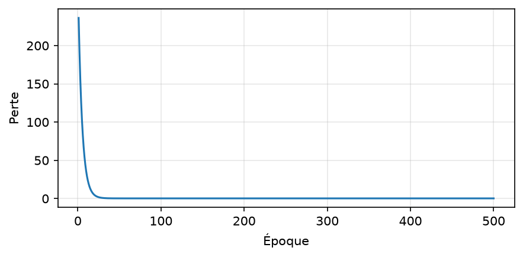
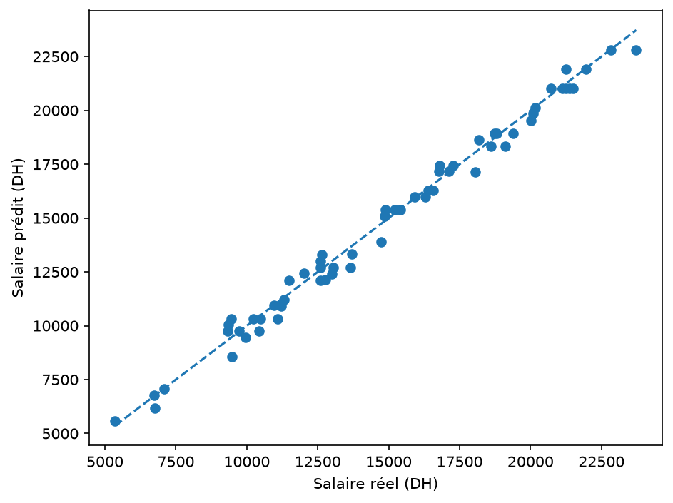
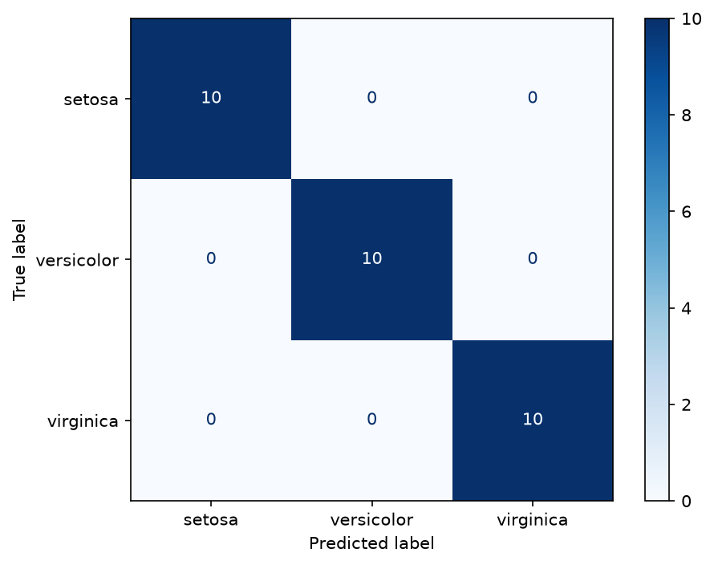
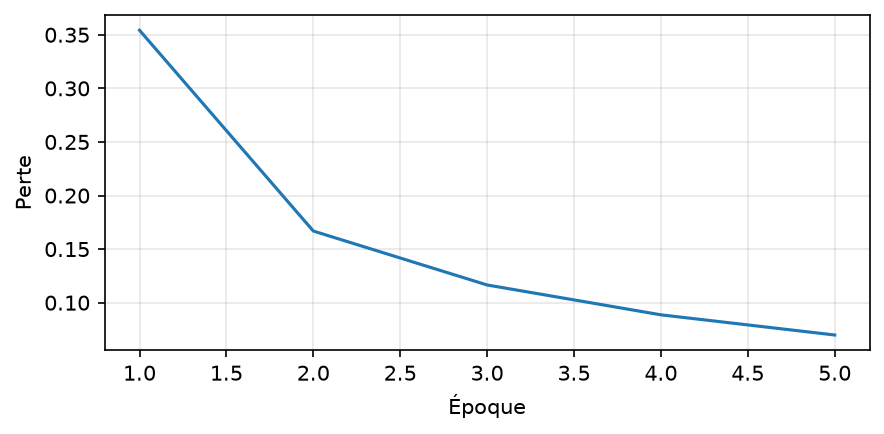
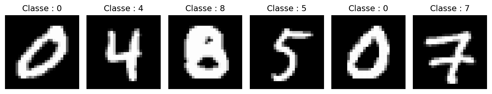

# TP 1 — Les bases de PyTorch

**Hiba Hamdaoui**  
**Objectif :** comprendre l'entraînement et l'évaluation des réseaux de neurones avec PyTorch à travers quatre exercices.

## 1. Régression : prédiction du salaire

J’ai généré 300 salariés fictifs avec deux variables : l'ancienneté (0 à 20 ans) et l'expertise (1 à 5). Le salaire est calculé à partir de la formule `4000 + 600 × ancienneté + 1500 × expertise + bruit`.

- Les données sont divisées en 240 exemples d'entraînement et 60 de test.
- Les entrées sont standardisées avec les statistiques de l'entraînement. Les salaires sont exprimés en milliers de DH pour faciliter l'apprentissage.
- Le modèle `nn.Linear(2, 1)` prédit le salaire. Il utilise MSELoss et SGD (taux d'apprentissage 0,05) pendant 500 époques.
- La MAE mesure l'écart absolu moyen entre les salaires réels et prédits, en DH.

### Résultats obtenus

| Indicateur | Valeur |
|---|---:|
| Salaire moyen | 15 010,55 DH |
| Perte finale (MSE, milliers de DH au carré) | 0,2391 |
| MAE sur le test | 381,64 DH |
| Salaire estimé (7 ans, expertise 4/5) | 14 201,94 DH |
| Salaire théorique sans bruit | 14 200 DH |




La perte diminue puis se stabilise. Les coefficients appris sont 592,66 DH par année, 1 490,75 DH par niveau d'expertise et un biais de 4 090,30 DH. Ils sont proches de ceux de la formule initiale. Le bruit explique les erreurs restantes. Une ancienneté de 40 ans est hors du domaine observé : la prédiction n'est donc pas garantie.



## 2. Classification : Iris

Le dataset Iris contient 150 fleurs, quatre mesures (longueur et largeur des sépales et des pétales) et trois espèces : setosa, versicolor et virginica.

- Séparation stratifiée : 120 fleurs pour l'entraînement et 30 pour le test.
- StandardScaler est ajusté uniquement sur l'entraînement pour éviter la fuite de données.
- Le réseau contient 4 entrées, 16 neurones cachés avec ReLU et 3 sorties. Le choix de 16 neurones est un paramètre de réalisation.
- CrossEntropyLoss et Adam (0,01) sont utilisés pendant 200 époques. Les étiquettes sont de type `torch.long` et les sorties sont des logits, sans Softmax.
- `argmax` donne la classe prédite ; l'accuracy mesure la proportion de bonnes classifications.

| Modèle | Accuracy sur le test |
|---|---:|
| Réseau avec couche cachée | 100 % |
| Modèle linéaire sans couche cachée | 90 % |




La matrice montre que les 30 fleurs du test sont correctement classées par le réseau avec couche cachée. La nouvelle fleur `[5.1, 3.5, 1.4, 0.2]` est prédite comme **setosa**. Le résultat de 100 % concerne uniquement ce petit jeu de test.


## 3. Classification MNIST avec un MLP

MNIST contient 60 000 images d'entraînement et 10 000 images de test représentant les chiffres de 0 à 9.

Le code réalise les étapes suivantes :
- Transformation des images en tenseurs et création de mini-lots de 64 images (256 pour le test).
- Aplatissement des images de 28 × 28 en 784 valeurs avec Flatten.
- Réseau de 784 entrées, 128 neurones cachés avec ReLU et 10 sorties.
- Entraînement pendant 5 époques avec Adam (0,001) et CrossEntropyLoss.
- Évaluation sur le test, calcul des métriques, matrice de confusion et affichage de dix erreurs maximum.
- Sauvegarde des poids dans `models/mnist_mlp.pth` et rechargement. Les classes prédites sont identiques sur le premier lot de 256 images du test.

Les métriques sont l'accuracy (proportion correcte), la précision (fiabilité des prédictions positives), le rappel (proportion des exemples d'une classe retrouvés) et le F1-score (équilibre précision/rappel). Pour les trois dernières, la moyenne macro donne le même poids à chaque chiffre.

Sur les cinq époques, la perte moyenne d'entraînement passe de **0,3542 à 0,0698**. Le MLP classe correctement **97,55 %** des images du test.




## 4. Classification MNIST avec un CNN

Contrairement au MLP, le CNN conserve la structure spatiale de l'image afin d'apprendre des motifs comme les contours.

Les images sont normalisées avec une moyenne de 0,1307 et un écart-type de 0,3081. Un lot de forme `[64, 1, 28, 28]` représente 64 images, un canal gris, 28 lignes et 28 colonnes. Le mélange des données évite de présenter les exemples dans le même ordre à chaque époque.



| Couche | Sortie hors batch |
|---|---|
| Entrée | 1 × 28 × 28 |
| Convolution + ReLU | 16 × 28 × 28 |
| MaxPooling | 16 × 14 × 14 |
| Convolution + ReLU | 32 × 14 × 14 |
| MaxPooling | 32 × 7 × 7 |
| Flatten | 1568 |
| Linear + ReLU + Dropout (0,25) | 128 |
| Linear | 10 |

Les convolutions utilisent des noyaux 3 × 3 et un padding de 1. Les deux poolings divisent la taille par deux. Dropout limite le surapprentissage en désactivant temporairement des neurones pendant l'entraînement.

Le modèle est entraîné pendant 3 époques avec Adam (0,001) et `CrossEntropyLoss`. La sortie de forme `[64, 10]` donne dix logits par image. La perte moyenne d'entraînement passe de **0,1846 à 0,0437**. Les poids sont sauvegardés dans `models/mnist_cnn.pth`.


### Comparaison sur le jeu de test MNIST

| Métrique | MLP | CNN |
|---|---:|---:|
| Accuracy | 97,55 % | 98,69 % |
| Précision macro | 97,53 % | 98,68 % |
| Rappel macro | 97,53 % | 98,68 % |
| F1-score macro | 97,53 % | 98,68 % |

Sur les mêmes 10 000 images de test, le CNN obtient **1,14 point de pourcentage** de plus que le MLP en accuracy, soit **114 images correctement classées de plus**.

## 5. Principe commun de l'entraînement

`model.train()` active le mode entraînement. À chaque itération, `zero_grad()` efface les anciens gradients, le modèle calcule les prédictions, la fonction de perte mesure l'erreur, `backward()` calcule les gradients et `step()` met à jour les paramètres. Pour le test, `model.eval()` et `torch.no_grad()` permettent de désactiver les comportements propres à l'entraînement et le calcul des gradients.

## 6. Exécution et état des résultats

Les quatre exercices ont été exécutés. Les résultats présentés proviennent des sorties enregistrées dans [le notebook](TP_PyTorch.ipynb). L'entraînement et l'évaluation des deux modèles MNIST se sont déroulés sur CPU.

Depuis le dossier `tp1`, j’ai utilisé les dépendances verrouillées du projet.

```powershell
uv sync --locked
uv run --with jupyterlab jupyter lab
```

Ouvrir `TP_PyTorch.ipynb` et exécuter toutes les cellules. Le premier téléchargement MNIST nécessite Internet. Le notebook affiche les résultats numériques, enregistre les figures dans `captures/` et sauvegarde les poids des modèles MNIST dans `models/`.

## Conclusion

La régression linéaire retrouve des coefficients proches de la formule de génération des salaires. Sur Iris, le réseau avec couche cachée classe correctement les 30 fleurs du test, contre 27 pour le modèle linéaire. Sur MNIST, le réseau convolutionnel obtient les meilleurs scores des deux modèles évalués.
