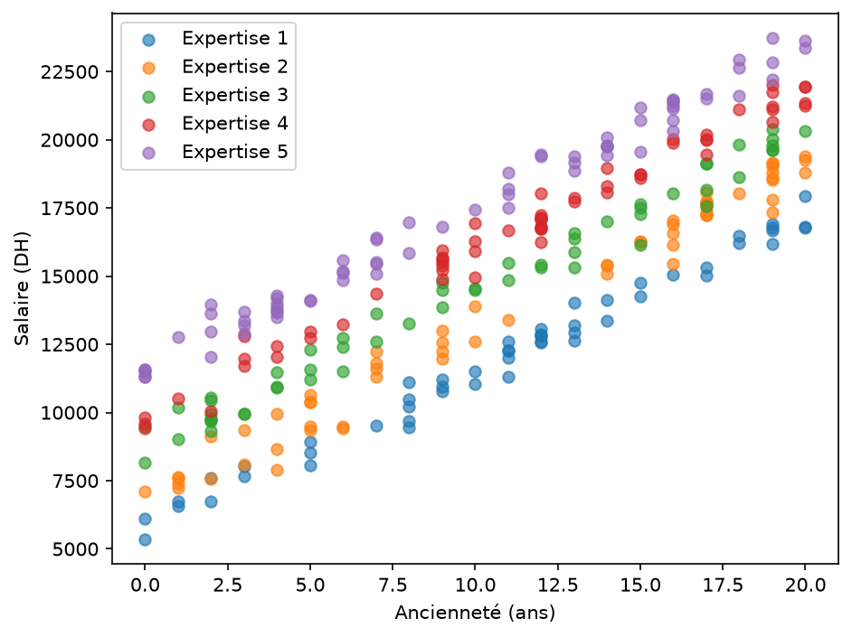
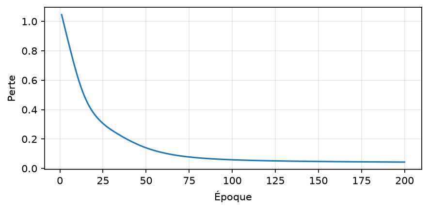
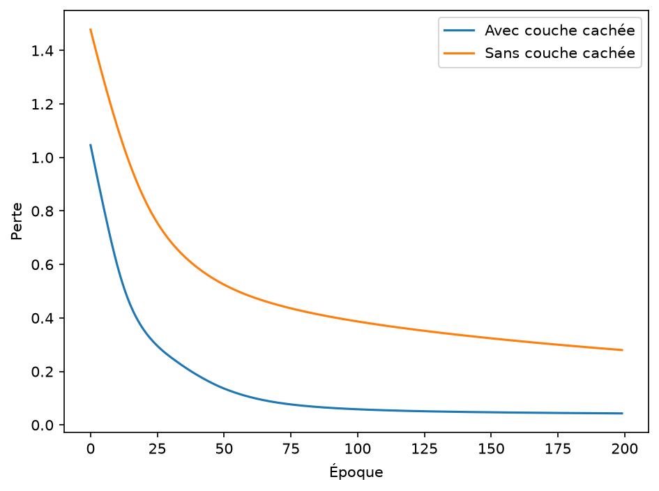
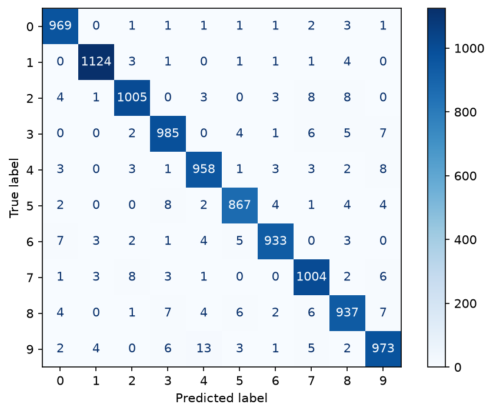
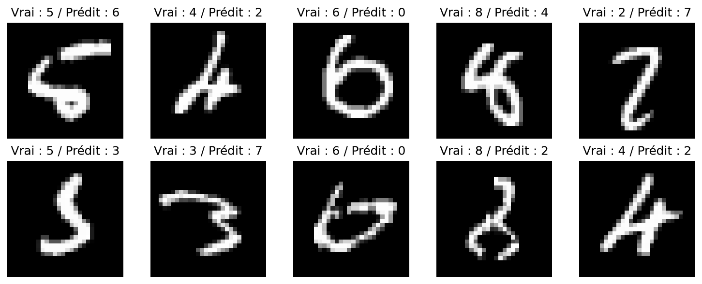
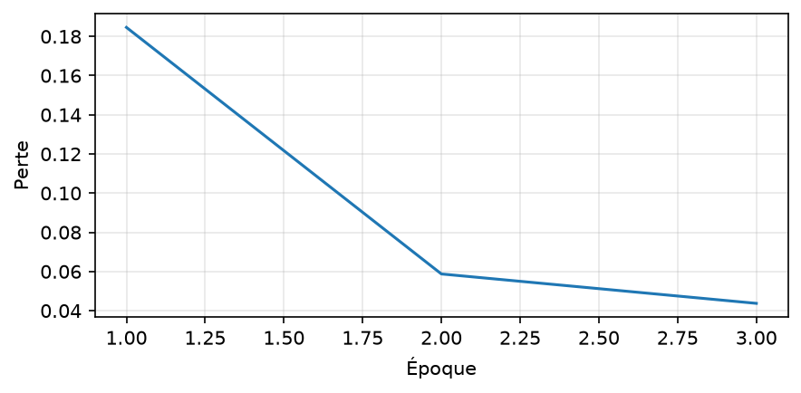
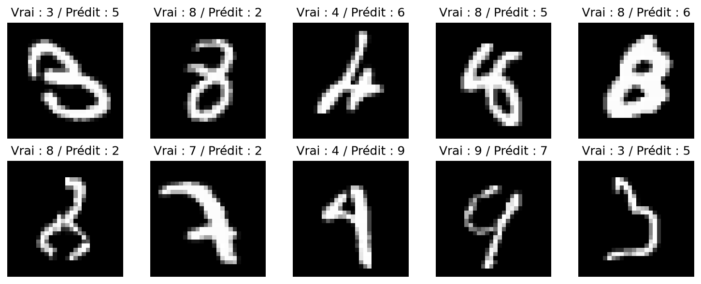

# Compte rendu du TP 1 — Les bases de PyTorch

**Hiba Hamdaoui**

## Introduction

Dans ce TP, j’ai utilisé PyTorch pour entraîner et évaluer quatre modèles. J’ai commencé par prédire un salaire à partir de données simulées, puis j’ai classé des fleurs du jeu Iris. Enfin, j’ai comparé deux réseaux de neurones sur les chiffres manuscrits de MNIST. Le [notebook du TP](TP_PyTorch.ipynb) contient le code et les sorties de l’exécution.

## 1. Prédiction du salaire par régression linéaire

J’ai simulé les salaires de 300 personnes à partir de leur ancienneté (0 à 20 ans) et de leur niveau d’expertise (1 à 5). La formule utilisée était `4 000 + 600 × ancienneté + 1 500 × expertise + bruit`. J’ai réservé 240 exemples à l’entraînement et 60 au test. J’ai standardisé les entrées à partir des statistiques de l’ensemble d’entraînement et exprimé les salaires en milliers de dirhams.

J’ai entraîné une couche linéaire `nn.Linear(2, 1)` pendant 500 époques avec la perte quadratique moyenne (MSE) et l’optimiseur SGD, avec un taux d’apprentissage de 0,05.

| Indicateur | Résultat |
|---|---:|
| Salaire moyen des 300 personnes | 15 010,55 DH |
| Perte finale d’entraînement, en milliers de DH au carré | 0,2391 |
| Erreur absolue moyenne sur le test | 381,64 DH |
| Salaire estimé pour 7 ans d’ancienneté et une expertise de 4/5 | 14 201,94 DH |
| Salaire théorique sans bruit pour le même profil | 14 200 DH |

Le modèle a appris une augmentation de 592,66 DH par année d’ancienneté et de 1 490,75 DH par niveau d’expertise, avec un biais de 4 090,30 DH. Ces valeurs sont proches des coefficients utilisés pour générer les salaires. Le bruit ajouté aux données explique une partie des écarts. Une prédiction à 40 ans d’ancienneté serait une extrapolation au-delà de la plage étudiée.




## 2. Classification des fleurs Iris

J’ai utilisé les quatre mesures des sépales et des pétales pour classer 150 fleurs en trois espèces (*setosa*, *versicolor* et *virginica*). J’ai effectué une séparation stratifiée en 120 fleurs d’entraînement et 30 fleurs de test. J’ai ajusté la standardisation sur les 120 fleurs d’entraînement, puis appliqué la même transformation aux fleurs de test.

J’ai entraîné pendant 200 époques un réseau à 4 entrées, une couche cachée de 16 neurones avec ReLU et 3 sorties. J’ai utilisé Adam avec un taux d’apprentissage de 0,01 et la fonction de perte `CrossEntropyLoss`. J’ai ensuite comparé les résultats à ceux d’un modèle linéaire sans couche cachée.

| Modèle | Fleurs correctement classées | Exactitude |
|---|---:|---:|
| Réseau avec couche cachée | 30 sur 30 | 100 % |
| Modèle linéaire | 27 sur 30 | 90 % |

Le réseau a prédit l’espèce *setosa* pour la fleur de mesures `[5.1, 3.5, 1.4, 0.2]`. Les 100 % d’exactitude correspondent aux 30 fleurs de ce jeu de test.





## 3. Reconnaissance des chiffres MNIST avec un MLP

J’ai utilisé les 60 000 images d’entraînement et les 10 000 images de test de MNIST. Le perceptron multicouche (MLP) aplatit chaque image de 28 × 28 pixels en 784 valeurs, puis utilise une couche cachée de 128 neurones avec ReLU et 10 sorties, une par chiffre.

J’ai entraîné le modèle sur CPU pendant cinq époques, par lots de 64 images, avec Adam (0,001) et `CrossEntropyLoss`. La perte moyenne d’entraînement est passée de 0,3542 à 0,0698 et le modèle a correctement classé **97,55 %** des images de test. J’ai sauvegardé les poids dans [mnist_mlp.pth](models/mnist_mlp.pth). Après rechargement, j’ai vérifié que les classes prédites étaient identiques sur le premier lot de 256 images de test.





## 4. Reconnaissance des chiffres MNIST avec un CNN

J’ai normalisé les images avec la moyenne 0,1307 et l’écart-type 0,3081. Le réseau convolutionnel (CNN) traite chaque image comme une grille de 28 × 28 pixels. Ses deux convolutions utilisent 16 puis 32 filtres de taille 3 × 3. Un max-pooling après chaque convolution réduit la grille de 28 × 28 à 14 × 14, puis à 7 × 7. J’ai aplati les 32 cartes obtenues en 1 568 valeurs avant de les transmettre à une couche de 128 neurones avec ReLU et un dropout de 0,25. La couche finale produit 10 scores, un par chiffre.


J’ai entraîné le CNN sur CPU pendant trois époques avec Adam (0,001) et `CrossEntropyLoss`. La perte moyenne d’entraînement est passée de 0,1846 à 0,0437. J’ai sauvegardé les poids dans [mnist_cnn.pth](models/mnist_cnn.pth).





### Comparaison des deux modèles sur MNIST

| Métrique sur les 10 000 images de test | MLP | CNN |
|---|---:|---:|
| Exactitude | 97,55 % | 98,69 % |
| Précision macro | 97,53 % | 98,68 % |
| Rappel macro | 97,53 % | 98,68 % |
| F1-score macro | 97,53 % | 98,68 % |

Les moyennes macro donnent le même poids à chaque chiffre. Sur ce jeu de test, le CNN a correctement classé **114 images de plus** que le MLP, soit un gain de **1,14 point de pourcentage**.

## Conclusion

Ce TP m’a permis de mettre en pratique les étapes d’un apprentissage supervisé avec PyTorch, de la préparation des données à l’évaluation sur un jeu de test. J’ai utilisé l’erreur absolue moyenne pour mesurer la qualité d’une prédiction de salaire et les matrices de confusion pour examiner les résultats en classification. Avec les configurations testées, l’ajout d’une couche cachée a amélioré le résultat sur Iris et le CNN a obtenu la meilleure exactitude sur MNIST.

## Reproduire les expériences

Dans un environnement Python, installer les dépendances et lancer Jupyter depuis le dossier du projet.

```bash
pip install torch torchvision scikit-learn matplotlib notebook
jupyter notebook
```

Ouvrir `TP_PyTorch.ipynb` et exécuter les cellules dans l’ordre. Le notebook enregistre les figures dans `captures/` et les poids des modèles MNIST dans `models/`. Si les données MNIST sont absentes, leur premier téléchargement nécessite une connexion Internet.
