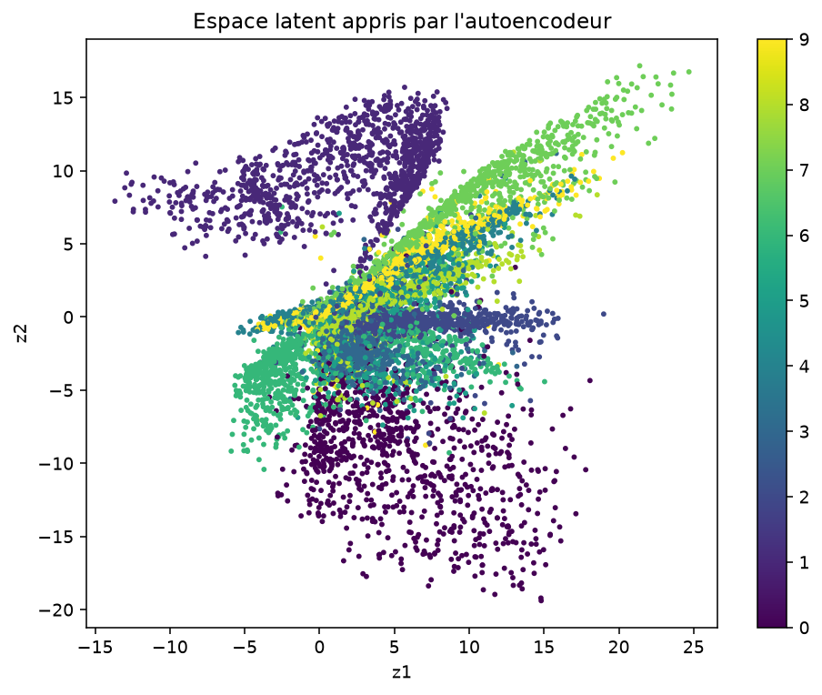
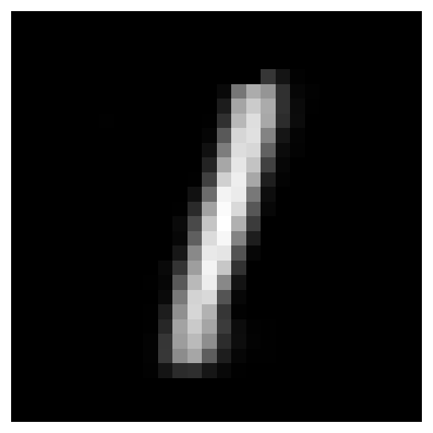
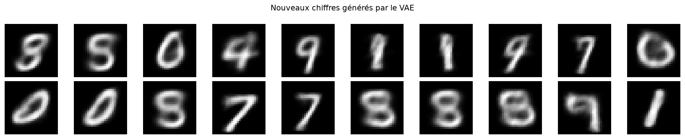

# TP 2 — Modèles génératifs avec PyTorch

## Objectif
J’ai comparé un modèle discriminatif, un autoencodeur simple et un autoencodeur variationnel (VAE), à partir du dataset MNIST.

## 0. Installation et lancement

Le projet utilise Python 3.13 et `uv` pour gérer ses dépendances. Depuis la racine du projet, j’ai utilisé les commandes suivantes.

```bash
uv sync --locked
uv run --locked --with jupyterlab jupyter lab
```

| Fichier ou dossier | Rôle |
|---|---|
| [TP_Modeles_Generatifs.ipynb](TP_Modeles_Generatifs.ipynb) | Entraînement, évaluation et visualisation des trois modèles |
| [pyproject.toml](pyproject.toml) et [uv.lock](uv.lock) | Dépendances et versions verrouillées |
| `data/` | Stockage local du jeu de données MNIST |
| [captures/](captures/) | Figures produites par le notebook |

## 1. Chargement du dataset
MNIST contient 60 000 images d’apprentissage et 10 000 images de test, de taille 28 × 28. Les pixels sont convertis en tenseurs entre 0 et 1. DataLoader permet de traiter les images par lots de 128.


## 2. Modèle discriminatif
Le modèle reçoit une image et prédit un chiffre entre 0 et 9. Il utilise une couche cachée de 128 neurones avec ReLU et une couche de sortie de 10 neurones. L’entraînement utilise Adam et CrossEntropyLoss pendant 3 époques. L’évaluation calcule l’accuracy manuellement et avec Torcheval.

Dans l’exécution de mon exécution, la perte passe de 0,4115 à 0,1374 et l’accuracy de test est de **96,37 %**.

## 3. Autoencodeur simple
L’encodeur réduit les 784 pixels à deux valeurs. Le décodeur utilise ces valeurs pour reconstruire l’image. Le modèle est entraîné sans labels pendant 5 époques avec Adam et la MSE. La perte d’entraînement de mon exécution diminue de 0,0650 à 0,0441. La MSE sur le jeu de test est de 0,0435.

### Reconstruction
La première ligne contient les images originales et la deuxième les reconstructions. La compression en deux dimensions peut faire perdre certains détails.


### Exploration de l’espace latent
Chaque image est représentée par un point. La couleur indique son chiffre réel. On peut aussi calculer le vecteur moyen des images du chiffre 1 puis le décoder.





## 4. VAE
Le VAE associe à chaque image une distribution latente gaussienne décrite par une moyenne et une log-variance. La reparamétrisation permet d’échantillonner un vecteur latent tout en propageant les gradients. La perte combine l’entropie croisée binaire (BCE) pour la reconstruction et la divergence KL, qui rapproche les distributions latentes de la loi normale standard. L’entraînement utilise Adam pendant 20 époques.

Dans mon exécution, la perte totale moyenne passe de 193,81 à 143,46 par image. Sur le test, la perte totale est de 144,63, dont 138,19 pour la reconstruction et 6,44 pour la divergence KL.

### Reconstruction et espace latent
Les images sont reconstruites après passage par l’encodeur et le décodeur. Les moyennes latentes sont représentées dans un plan 2D.


### Génération de nouvelles images
Le décodeur reçoit des vecteurs aléatoires tirés d’une loi normale. Il peut donc produire des images sans recevoir une image originale. Une grille de points permet d’observer les transitions dans l’espace latent.




## 5. Comparaison et conclusion

| Modèle | Objectif | Labels nécessaires à l’entraînement | Perte |
|---|---|---|---|
| Classifieur | Reconnaître un chiffre | Oui | CrossEntropy |
| Autoencodeur | Reconstruire une image | Non | MSE |
| VAE | Reconstruire et générer des images | Non | BCE + KL |

Le classifieur sert à reconnaître les chiffres. L’autoencodeur apprend à compresser et reconstruire les images. Le VAE facilite en plus la génération de nouvelles images grâce à son espace latent régularisé.

## Note sur les résultats

J’ai relevé les valeurs dans les sorties enregistrées du notebook publié. Les cellules de visualisation régénèrent les figures dans `captures/`.
