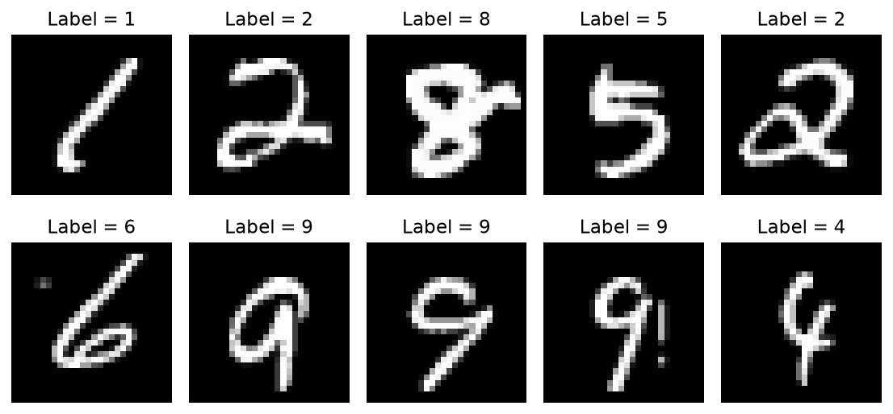
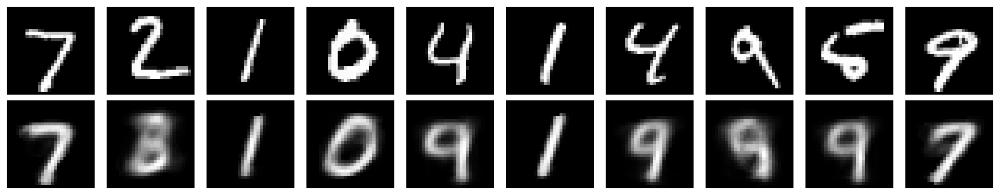
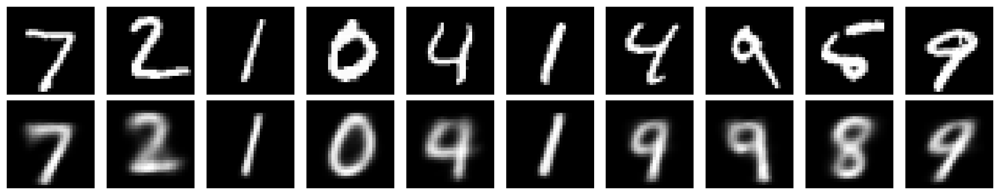
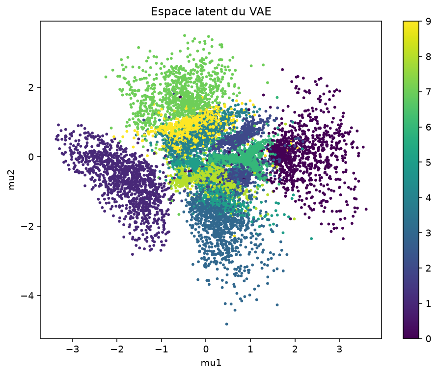
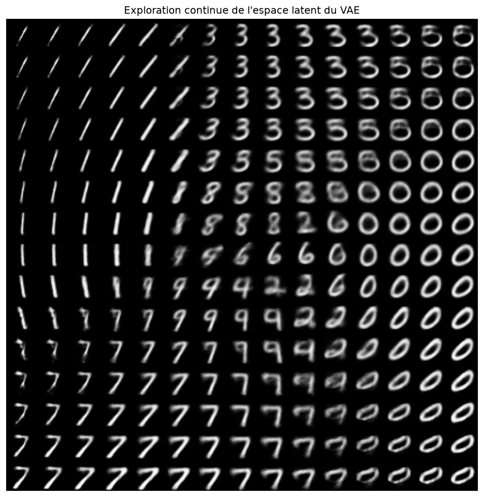

# Compte rendu du TP 2 — Modèles génératifs avec PyTorch

**Hiba Hamdaoui**

## Introduction

Dans ce TP, j’ai utilisé PyTorch pour comparer trois modèles sur les chiffres manuscrits de MNIST. J’ai d’abord entraîné un classifieur à reconnaître les chiffres, puis un autoencodeur à reconstruire les images à partir de deux valeurs. J’ai ensuite utilisé un autoencodeur variationnel (VAE) pour reconstruire et générer des chiffres. Le [notebook du TP](TP_Modeles_Generatifs.ipynb) contient le code et les résultats enregistrés.

## Installation

Le projet utilise Python 3.13 et `uv`. Depuis le dossier du TP, exécuter les commandes suivantes.

```powershell
uv sync --locked
uv run --locked --with jupyterlab jupyter lab
```

Ouvrir `TP_Modeles_Generatifs.ipynb` et exécuter les cellules dans l’ordre. Le notebook télécharge MNIST dans `data/` si nécessaire.

## 1. Préparation de MNIST

J’ai utilisé les 60 000 images d’entraînement et les 10 000 images de test. Chaque image mesure 28 × 28 pixels. J’ai converti les pixels en tenseurs avec des valeurs comprises entre 0 et 1, puis regroupé les images par lots de 128.



## 2. Classification des chiffres

J’ai entraîné un réseau qui reçoit les 784 pixels d’une image, les traite avec une couche cachée de 128 neurones avec ReLU, puis produit 10 scores, un par chiffre. J’ai utilisé Adam et `CrossEntropyLoss` pendant trois époques.

La perte moyenne d’entraînement est passée de 0,4115 à 0,1374. Le modèle a correctement classé **96,37 %** des images de test. Le calcul manuel et Torcheval donnent la même exactitude.

## 3. Reconstruction avec un autoencodeur

J’ai entraîné un autoencodeur pendant cinq époques avec Adam et l’erreur quadratique moyenne (MSE). L’encodeur résume les 784 pixels en deux valeurs et le décodeur utilise ces valeurs pour reconstruire l’image. La MSE d’entraînement est passée de 0,0650 à 0,0441 et la MSE sur le jeu de test est de **0,0435**.

La première ligne montre les images originales et la seconde leurs reconstructions. La compression en deux dimensions entraîne une perte de détails.



J’ai représenté chaque image par un point dans l’espace latent et utilisé le chiffre réel comme couleur. J’ai aussi calculé la moyenne des vecteurs latents des images du chiffre 1, puis décodé ce vecteur moyen.


## 4. Reconstruction et génération avec un VAE

Le VAE associe à chaque image une distribution gaussienne latente décrite par une moyenne et une log-variance. La reparamétrisation permet d’échantillonner un vecteur latent tout en propageant les gradients. J’ai entraîné le modèle pendant 20 époques avec Adam. La perte combine l’entropie croisée binaire (BCE) pour la reconstruction et la divergence KL pour rapprocher les distributions latentes de la loi normale standard.

La perte totale moyenne d’entraînement est passée de 193,81 à 143,46 par image. Sur le jeu de test, elle atteint **144,63**, dont 138,19 pour la reconstruction et 6,44 pour la divergence KL.




Pour générer de nouvelles images, j’ai décodé des vecteurs tirés d’une loi normale standard. J’ai aussi décodé une grille de points pour observer comment les chiffres changent selon leur position dans l’espace latent.




## Conclusion

| Modèle | Objectif | Étiquettes utilisées à l’entraînement | Fonction de perte |
|---|---|---|---|
| Classifieur | Reconnaître un chiffre | Oui | Entropie croisée |
| Autoencodeur | Compresser et reconstruire une image | Non | MSE |
| VAE | Reconstruire et générer des images | Non | BCE et divergence KL |

Le classifieur apprend à associer chaque image à un chiffre. L’autoencodeur apprend une représentation compacte des images. Le VAE régularise cette représentation pour permettre la génération de chiffres à partir de vecteurs échantillonnés dans l’espace latent.
