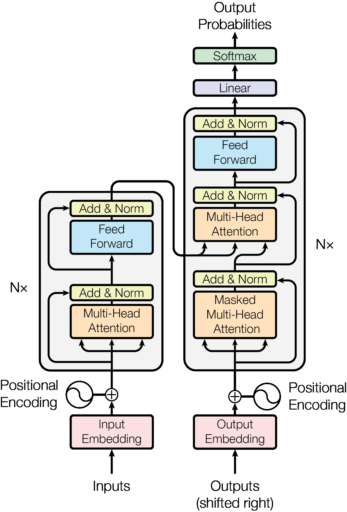
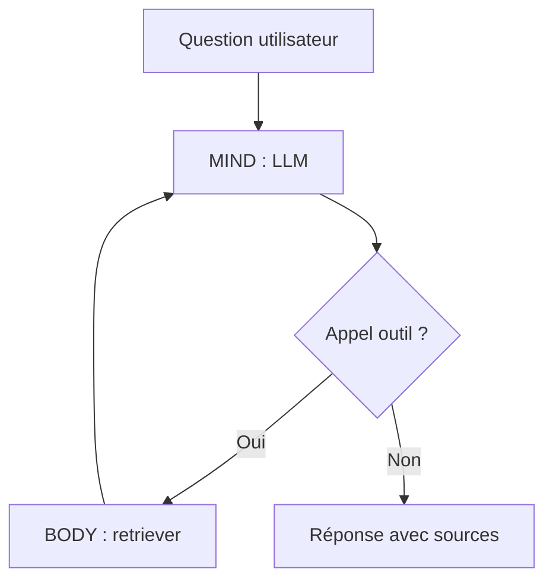

# TP 3 — RAG multimodal et agentique

**Étudiante : Hamdaoui Hiba — 5IADA**

## Objectif
J’ai développé un assistant capable de rechercher du texte et des images dans l’article *Attention Is All You Need*, puis de répondre aux questions en indiquant ses sources.

## 0. Préparation du projet
Le projet utilise UV pour gérer les dépendances. PyMuPDF sert à lire le PDF, CLIP à créer les embeddings, ChromaDB à les stocker et LangGraph à construire l’agent.

```powershell
uv sync --locked
uv run --with jupyterlab jupyter lab
```

Le [PDF utilisé](pdfs/attention_is_all_you_need.pdf) est fourni au chemin attendu par le notebook. J’ai exécuté les cellules d’extraction et d’indexation dans l’ordre. Le premier lancement télécharge CLIP. Pour essayer l’agent, le notebook demande une clé API OpenAI via une invite masquée.

## 1. Extraction du contenu
Le PDF est parcouru page par page. Le texte est sauvegardé dans des fichiers `.txt` et les images intégrées sont enregistrées dans un dossier séparé. Le numéro de page permet de retrouver leur provenance. Cette méthode ne récupère pas automatiquement les dessins vectoriels ni le texte scanné.

Dans l’exécution enregistrée, j’ai extrait 15 pages et 3 images.



## 2. Vectorisation avec CLIP
Le texte est découpé en fragments de 60 tokens avec un chevauchement de 10 tokens pour conserver le contexte. CLIP ViT-B-32 transforme chaque fragment et chaque image en vecteurs dans le même espace. On normalise les vecteurs pour faciliter la comparaison. Le notebook vérifie la norme et la dimension des vecteurs.

## 3. Indexation dans ChromaDB
L’empreinte SHA-256 identifie le document. Les vecteurs sont enregistrés avec le type de contenu, la page et le chemin du fichier. La base est persistante et la réindexation évite les doublons pour le même PDF.

Résultats enregistrés dans le notebook publié.

| Élément | Nombre |
|---|---:|
| Pages | 15 |
| Fragments textuels | 208 |
| Images | 3 |
| Total indexé | 211 |

## 4. Recherche multimodale
La requête texte ou image est encodée avec CLIP. ChromaDB renvoie les éléments les plus proches selon la similarité cosinus. Le filtre permet de demander uniquement les textes ou les images.

Les sorties enregistrées montrent des résultats textuels et visuels avec leur page et leur score. Les figures retrouvées sont visibles dans la sortie de recherche du [notebook](TP_RAG_Multimodal.ipynb).

## 5. Outil de recherche
La fonction `retriever_tool` encapsule la recherche. Elle accepte une question, un type de résultat et un nombre de résultats. Quand une image accompagne la question, les deux recherches sont combinées par fusion des rangs (RRF). L’outil fournit les textes, les images et leurs références au modèle.

## 6. Agent ReAct
Le LLM représente le MIND et le retriever représente le BODY. LangGraph organise le cycle : le modèle choisit une action, l’outil recherche des sources, puis le modèle utilise ces observations pour répondre ou relancer une recherche.



## 7. Tests et validation
Le notebook propose cinq cas : question sur l’attention multi-têtes, recherche de figure, comparaison de deux notions, information absente et question accompagnée d’une image. La trace permet de vérifier les appels à l’outil. Il faut également contrôler la pertinence des sources et les pages citées.

Dans l’exécution enregistrée, l’agent n’a pas atteint les scénarios de question-réponse. L’initialisation s’est arrêtée sur une erreur d’import de `ModelRefusalError` dans `langchain_core`. Les résultats documentés concernent donc l’extraction, l’indexation et la recherche.

## Conclusion
Le système permet de relier le texte et les images à une question documentaire et d’utiliser un agent pour choisir les recherches. Les limites principales sont la longueur des entrées CLIP, la compréhension des figures scientifiques et la nécessité de vérifier les citations.
