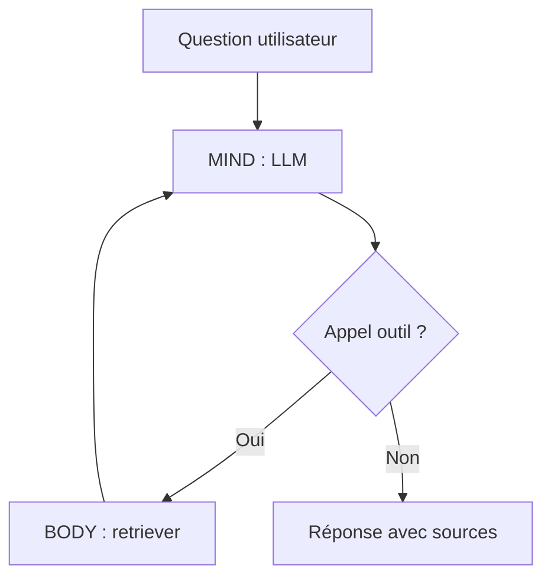

# TP — RAG multimodal et agentique

**Étudiante : Hamdaoui Hiba — 5IADA**

## Objectif
Réaliser un assistant capable de rechercher du texte et des images dans l’article *Attention Is All You Need*, puis de répondre aux questions en indiquant ses sources.

## 0. Préparation du projet
Le projet utilise UV pour gérer les dépendances. PyMuPDF sert à lire le PDF, CLIP à créer les embeddings, ChromaDB à les stocker et LangGraph à construire l’agent.

```powershell
uv sync
uv run jupyter lab
```

Déposer le PDF dans `pdfs/attention is all you need.pdf` (article disponible sur https://arxiv.org/pdf/1706.03762). Ouvrir le notebook et exécuter les cellules dans l’ordre. Le premier lancement télécharge CLIP. Pour l’agent, renseigner une clé API OpenAI à l’invite masquée ; des frais API peuvent s’appliquer.

## 1. Extraction du contenu
Le PDF est parcouru page par page. Le texte est sauvegardé dans des fichiers `.txt` et les images intégrées sont enregistrées dans un dossier séparé. Le numéro de page permet de retrouver leur provenance. Cette méthode ne récupère pas automatiquement les dessins vectoriels ni le texte scanné.

Dans le notebook source, l’extraction a donné 11 pages et 3 images.


## 2. Vectorisation avec CLIP
Le texte est découpé en fragments de 60 tokens avec un chevauchement de 10 tokens pour conserver le contexte. CLIP ViT-B-32 transforme chaque fragment et chaque image en vecteurs dans le même espace. On normalise les vecteurs pour faciliter la comparaison. Le notebook vérifie la norme et la dimension des vecteurs.

## 3. Indexation dans ChromaDB
L’empreinte SHA-256 identifie le document. Les vecteurs sont enregistrés avec le type de contenu, la page et le chemin du fichier. La base est persistante et la réindexation évite les doublons pour le même PDF.

Résultats enregistrés dans le notebook source :

| Élément | Nombre |
|---|---:|
| Pages | 11 |
| Fragments textuels | 171 |
| Images | 3 |
| Total indexé | 174 |

## 4. Recherche multimodale
La requête texte ou image est encodée avec CLIP. ChromaDB renvoie les éléments les plus proches selon la similarité cosinus. Le filtre permet de demander uniquement les textes ou les images.

Dans le notebook source, une recherche avec une image déjà indexée a retrouvé cette même image avec une similarité de 1,000. Cela vérifie la recherche d'une image identique, mais ne suffit pas à mesurer la qualité générale du système.


## 5. Outil de recherche
La fonction `retriever_tool` encapsule la recherche. Elle accepte une question, un type de résultat et un nombre de résultats. Quand une image accompagne la question, les deux recherches sont combinées par fusion des rangs (RRF). L’outil fournit les textes, les images et leurs références au modèle.

## 6. Agent ReAct
Le LLM représente le MIND et le retriever représente le BODY. LangGraph organise le cycle : le modèle choisit une action, l’outil recherche des sources, puis le modèle utilise ces observations pour répondre ou relancer une recherche.



## 7. Tests et validation
Le notebook propose cinq cas : question sur l’attention multi-têtes, recherche de figure, comparaison de deux notions, information absente et question accompagnée d’une image. La trace permet de vérifier les appels à l’outil. Il faut également contrôler la pertinence des sources et les pages citées.

Le notebook source contient un appel observé à `consulter_pdf` sur l’attention multi-têtes et une recherche en plusieurs étapes. La nouvelle version utilise `retriever_tool` et un graphe explicite. Les sorties historiques ne constituent donc pas une validation du nouveau graphe.


## Conclusion
Le système permet de relier le texte et les images à une question documentaire et d’utiliser un agent pour choisir les recherches. Les limites principales sont la longueur des entrées CLIP, la compréhension des figures scientifiques et la nécessité de vérifier les citations.

**État de validation :** le code du nouveau notebook a été vérifié syntaxiquement. Le PDF et les poids CLIP ne sont pas fournis et aucune clé API n’a été utilisée ici ; les entraînements ne sont pas nécessaires mais l’indexation et les tests de l’agent doivent être exécutés localement. Les images et les fichiers texte dans `captures/` proviennent uniquement des sorties enregistrées dans le notebook fourni, et non d’une nouvelle exécution.
