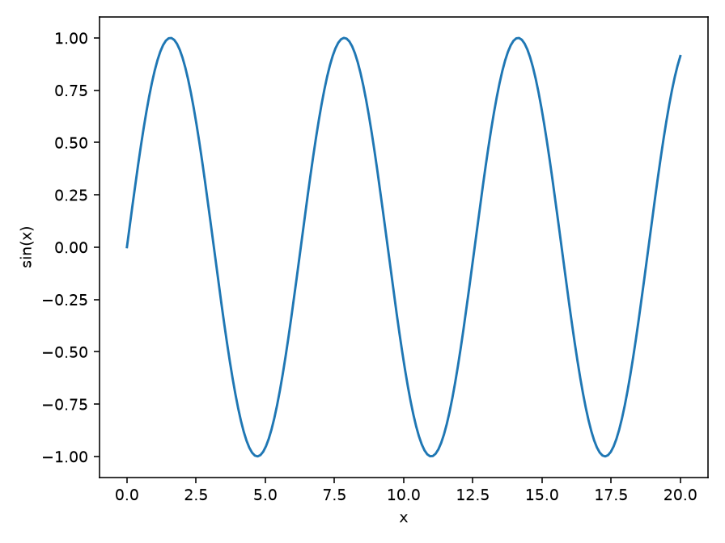
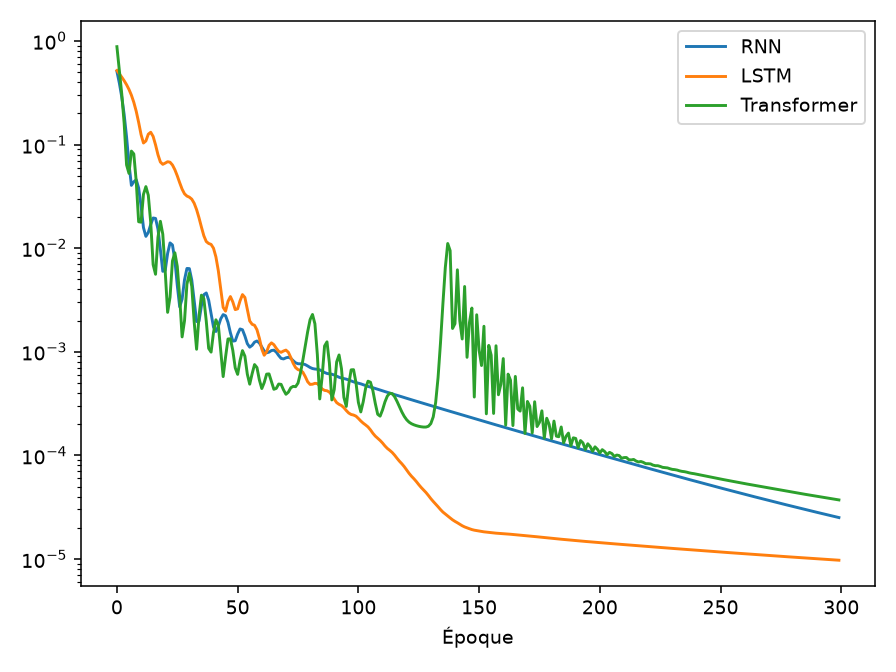
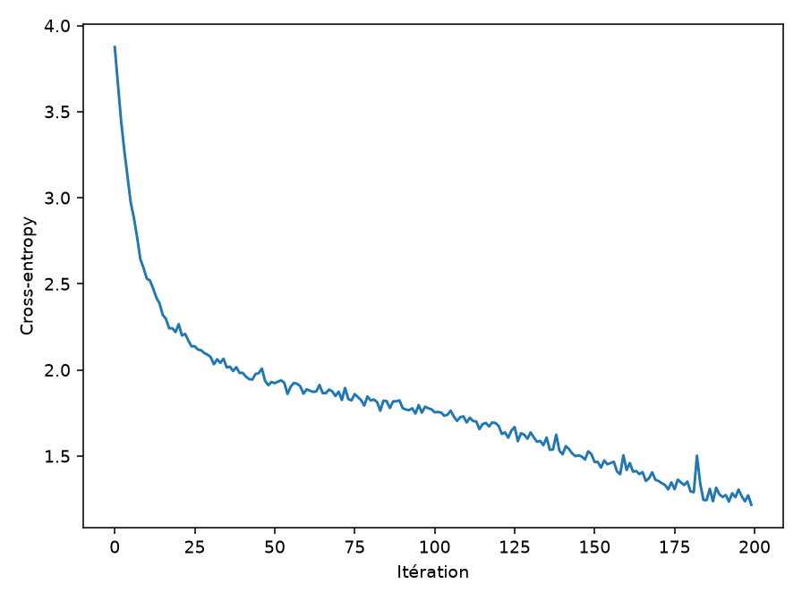

# TP 4 — Architecture Transformer

## Objectif
Ce TP permet de comprendre les modèles de traitement des séquences et de découvrir le fonctionnement des architectures GPT et BERT avec PyTorch.

## Installation
Dans le dossier du projet :

```powershell
uv sync
uv run jupyter lab
```

Ouvrir `TP_Transformer.ipynb` et lancer les cellules dans l'ordre. Le fichier `corpus.txt` est fourni. Pour l'exercice 1, télécharger le dataset [Individual Household Electric Power Consumption](https://archive.ics.uci.edu/dataset/235/individual+household+electric+power+consumption), décompresser l'archive et placer `household_power_consumption.txt` à côté du notebook. GPT-2 et BERT nécessitent une connexion Internet pour le premier téléchargement.

## Partie 1 — Prédiction de séries temporelles
Nous avons généré 200 valeurs de la fonction sin(x). Chaque entrée contient 10 valeurs successives et la cible correspond à la valeur suivante. Les 150 premières fenêtres servent à l'entraînement et les 40 dernières au test.



Nous avons entraîné trois modèles pendant 300 époques avec Adam et la perte MSE :

- RNN : utilise un état caché pour mémoriser les valeurs précédentes.
- LSTM : utilise des portes pour contrôler les informations conservées dans sa mémoire.
- Transformer : utilise l'attention pour relier les valeurs de la séquence et un encodage positionnel pour connaître leur ordre.

### Résultats obtenus sur le test

| Modèle | MSE | MAE |
|---|---:|---:|
| RNN | 0.000028 | 0.004562 |
| LSTM | 0.000010 | 0.002636 |
| Transformer | 0.000053 | 0.006335 |

Le LSTM obtient ici la plus petite erreur. Les trois modèles suivent bien la sinusoïde. Ce résultat concerne uniquement cette expérience.




### GPT-2 et BERT
GPT-2 utilise un modèle préentraîné pour compléter un texte anglais. Le tokenizer transforme le texte en identifiants, puis le modèle génère de nouveaux tokens successivement. BERT reçoit une phrase contenant un masque et propose les tokens les plus probables grâce au contexte à gauche et à droite. Ces deux exemples sont codés mais non exécutés ici, car la bibliothèque transformers et les poids ne sont pas disponibles.

## Partie 2 — Exercice 1 : prédiction de la consommation électrique
Les mesures de puissance sont regroupées par heure. Une heure doit contenir au moins 45 mesures valides. Les fenêtres contenant des valeurs manquantes sont écartées. Les données sont divisées chronologiquement en 70 % entraînement, 15 % validation et 15 % test. La moyenne et l'écart-type sont calculés uniquement sur l'entraînement.

Le modèle reçoit 24 heures, projette les valeurs en dimension 32, ajoute les positions puis utilise deux couches Transformer à quatre têtes. La dernière représentation permet de prédire la puissance de l'heure suivante. Adam (0,001) et MSE sont utilisés pendant 20 époques ; le meilleur modèle est choisi sur la validation.

Les prédictions sont dénormalisées en kW. Le notebook calcule MAE et RMSE et compare le Transformer avec la dernière heure observée et la même heure de la veille. Il trace également sept jours calendaires du test (les fenêtres invalides sont exclues).

**État :** le dataset UCI n'étant pas fourni, aucun résultat numérique n'est annoncé pour cet exercice.

Une fenêtre de 168 heures pourrait représenter les habitudes hebdomadaires, mais il faut la tester. Ajouter l'heure et le jour aiderait le modèle à distinguer les habitudes de consommation. Normaliser sur le train évite une fuite d'informations. Pour prédire des kWh, il faut intégrer la puissance sur la durée : chaque mesure minute en kW est multipliée par 1/60 heure, avec une gestion des mesures manquantes.

## Exercice 2 — Mini-GPT
Un corpus pédagogique généré est fourni. Le texte est transformé en caractères numériques et découpé en fenêtres de 64 caractères. Les cibles sont décalées d'une position pour apprendre le caractère suivant.

Le modèle utilise des embeddings de dimension 64, deux blocs GPT à quatre têtes, des normalisations, des connexions résiduelles et un MLP 64-256-64. Le masque causal empêche de regarder les caractères futurs. La perte d'entropie croisée est calculée sur toutes les positions.

Après 200 itérations, la perte de validation obtenue sur un lot est de 1,535. Le test causal réussit : changer un caractère futur ne modifie pas les prédictions précédentes. Le notebook génère 200 nouveaux caractères avec trois températures (0,5 ; 1 ; 1,5). Les textes restent peu cohérents, car le corpus est petit et répétitif et l'entraînement court. Une température basse favorise les caractères probables ; une température haute augmente la diversité. Sans masque, le modèle pourrait apprendre en regardant les réponses futures.



## Exercice 3 — Mini-BERT
Nous utilisons un petit corpus de phrases, séparé en entraînement et validation. Chaque phrase est encodée avec les tokens spéciaux CLS, SEP et PAD, jusqu'à 32 positions. Le vocabulaire est construit sur le train.

Environ 15 % des mots ordinaires sont sélectionnés, avec au moins un mot par phrase. Parmi eux, 80 % sont remplacés par MASK, 10 % par un mot aléatoire et 10 % sont conservés. Le modèle comprend deux encodeurs Transformer à quatre têtes et des embeddings de dimension 64. Le masque de padding empêche de tenir compte des positions inutiles. La perte ne concerne que les mots sélectionnés, grâce à ignore_index=-100.

Après 60 époques, l'exactitude observée sur un tirage de masques de validation est de 100 %. Ce chiffre repose sur seulement quatre phrases et ne permet pas de conclure à une bonne généralisation. Les propositions pour les mots explicitement masqués restent parfois incorrectes. Le test de padding réussit : changer les tokens de remplissage ne change pas les prédictions utiles.


BERT regarde les deux côtés du mot masqué grâce à son attention bidirectionnelle. La perte est limitée aux positions sélectionnées pour éviter d'apprendre simplement à recopier la phrase. Contrairement à GPT, BERT reconstruit des mots manquants plutôt que de produire directement la suite.

## Conclusion
Ce TP illustre la différence entre les modèles récurrents, les Transformers et les deux objectifs de modélisation du langage. Les expériences sur la sinusoïde et les deux mini-modèles ont été exécutées ; les graphiques sont issus de ces exécutions. L'exercice énergétique et les deux modèles préentraînés restent à lancer après installation des ressources nécessaires.
