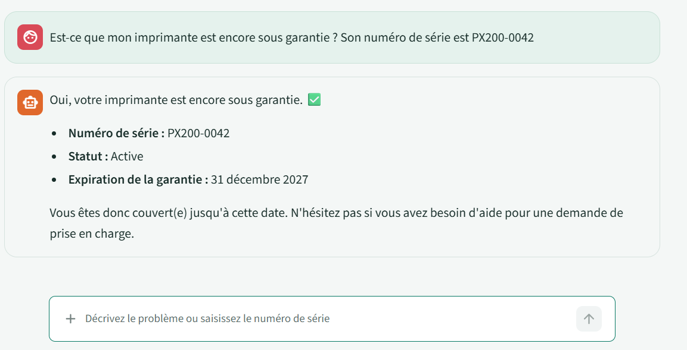
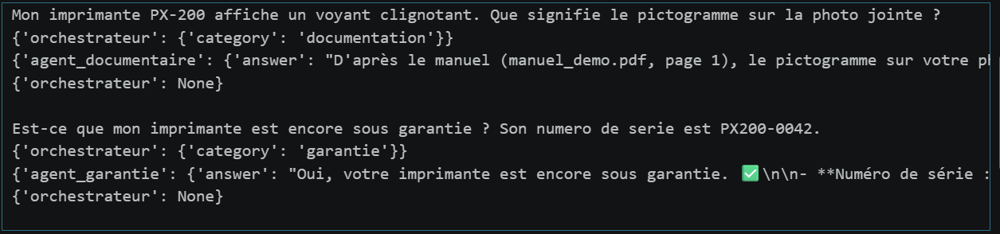
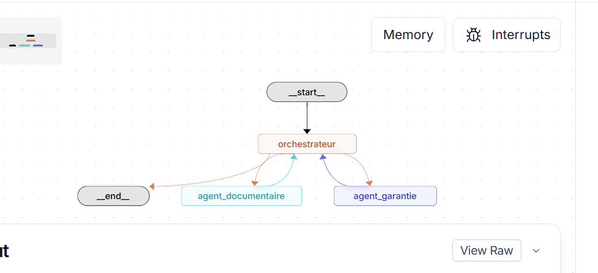
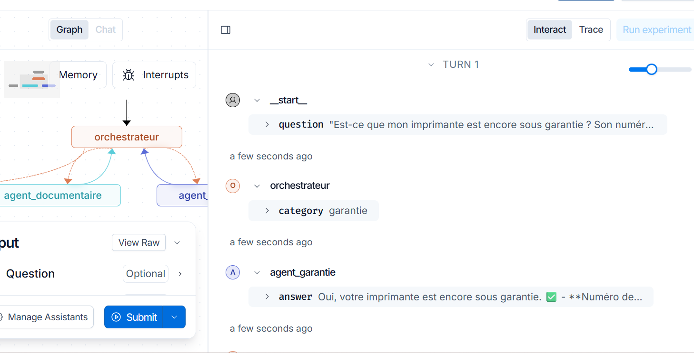

# Compte rendu — TP 5, partie D · Assistance SAV

## Objectif

Dans la partie D du TP, j’ai réalisé un chatbot pour le service après-vente d’un distributeur d’appareils électroniques. Le client peut décrire une panne et joindre une photo de l’appareil, ou vérifier une garantie à partir d’un numéro de série. J’ai utilisé Streamlit pour l’interface et un notebook pour observer l’exécution du graphe LangGraph.

Pour la démonstration, j’ai utilisé un manuel fictif du PX-200, une photo du pictogramme et un registre de garanties fictif.

## Architecture et étapes de réalisation


1. **Préparation des données.** J’ai regroupé le manuel `manuel_demo.pdf`, la photo `img_px200_01.png` et le registre `garanties.json` dans le dossier `data/`.
2. **Indexation du manuel.** J’ai utilisé PyMuPDF pour extraire les passages et les images incorporées, puis CLIP pour encoder le texte et les images dans un même espace vectoriel. J’ai stocké ces vecteurs dans ChromaDB avec le nom du manuel et le numéro de page pour retrouver et citer les sources. [Module d’indexation](multimodal.py).
3. **Recherche documentaire via MCP.** J’ai exposé `rag_multimodal` à l’adresse `http://127.0.0.1:23000/mcp` via Streamable HTTP. L’outil recherche des passages et des figures à partir de la question et, si elle est disponible, de la photo. Le modèle Groq utilise les éléments retrouvés pour rédiger une réponse qui cite le manuel et la page. [Serveur MCP](sav_server.py).
4. **Vérification de la garantie.** J’ai relié l’outil local `consulter_garantie` à un registre en lecture seule. L’outil normalise le numéro de série et compare la date d’expiration à la date du jour. Il distingue les garanties actives, les garanties expirées et les numéros inconnus. [Registre des garanties](registry.py).
5. **Orchestration des demandes.** J’ai construit un graphe qui dirige chaque demande vers une seule catégorie, `documentation` ou `garantie`. L’agent documentaire appelle le serveur MCP et l’agent garantie utilise l’outil local. Dès que l’agent sélectionné fournit une réponse, l’orchestrateur termine l’exécution. [Graphe SAV](sav_graph.py).
6. **Présentation du résultat.** J’ai créé une interface qui affiche les messages, les photos jointes et le temps écoulé pendant le traitement. Elle affiche un message si la demande dépasse 75 secondes. J’ai aussi utilisé le notebook pour afficher les événements du graphe et suivre le routage. [Interface Streamlit](app.py) · [Notebook](TP5_Agent_MCP_Groq.ipynb).

## Mise en route

J’ai installé les dépendances avec PowerShell depuis le dossier du projet.

```powershell
uv sync
```

J’ai configuré `GROQ_API_KEY` dans le fichier `.env`. La commande suivante prépare le fichier à partir de `.env.example` s’il est absent. La connexion Internet sert aux appels Groq et, si nécessaire, au téléchargement initial des poids CLIP.

```powershell
if (-not (Test-Path -LiteralPath .env)) {
    Copy-Item -LiteralPath .env.example -Destination .env
}
```

Dans un premier terminal, j’ai lancé le serveur MCP et je l’ai laissé ouvert pendant les essais.

```powershell
uv run python sav_server.py
```

Dans un deuxième terminal, j’ai démarré le chatbot, puis j’ai ouvert l’adresse affichée, généralement `http://localhost:8501`.

```powershell
uv run streamlit run app.py
```

## Tests dans Streamlit


### 1. Dépannage avec photo

J’ai demandé ce que signifiait le pictogramme associé au voyant clignotant du PX-200 et j’ai joint la photo avec le trombone. Pour ce test, j’attendais l’identification d’un problème d’alimentation papier et une citation de `manuel_demo.pdf`, page 1. [Photo utilisée](data/img_px200_01.png).


### 2. Vérification de garantie

J’ai demandé si l’imprimante portant le numéro `PX200-0042` était encore sous garantie. Le registre indique une expiration le **31 décembre 2027**. J’attendais donc un statut actif à la date de mon essai.



## Tests dans le notebook

Dans VS Code, j’ai sélectionné le noyau `.venv\Scripts\python.exe` et exécuté la cellule avec le serveur MCP en cours d’exécution. J’ai testé le dépannage avec la référence photo `img_px200_01`, puis la garantie du numéro `PX200-0042`. [Notebook du TP](TP5_Agent_MCP_Groq.ipynb).

| Cas | Routage observé dans les sorties enregistrées | Réponse observée |
| --- | --- | --- |
| Dépannage avec photo | `orchestrateur` → `documentation` → `agent_documentaire` → `orchestrateur` | Problème d’alimentation papier, avec référence à `manuel_demo.pdf`, page 1. |
| Vérification de garantie | `orchestrateur` → `garantie` → `agent_garantie` → `orchestrateur` | Garantie active pour `PX200-0042`, avec expiration le 31 décembre 2027. |

Le dernier événement `{'orchestrateur': None}` indique que l’orchestrateur ne modifie plus l’état. La réponse produite par l’agent est déjà disponible et le graphe se termine.




## Visualisation dans LangGraph Studio

J’ai déclaré le graphe `sav` dans la configuration LangGraph. Avec le serveur MCP toujours ouvert, j’ai démarré le serveur de développement dans un autre terminal. [Configuration LangGraph](langgraph.json).

```powershell
uv run langgraph dev
```

J’ai ouvert le lien **Studio UI** dans le terminal et sélectionné le graphe `sav`. J’ai ainsi visualisé les deux branches, leur retour vers l’orchestrateur et la sortie `END`. Les deux entrées ci-dessous permettent de reproduire les scénarios dans Studio et d’inspecter les nœuds traversés ainsi que l’état final.

**Dépannage avec photo**

```json
{
  "question": "Mon imprimante PX-200 affiche un voyant clignotant. Que signifie le pictogramme sur la photo jointe ?",
  "image_ref": "img_px200_01"
}
```

**Vérification de garantie**

```json
{
  "question": "Est-ce que mon imprimante est encore sous garantie ? Son numéro de série est PX200-0042."
}
```






## Tests du registre

J’ai vérifié les cas de garantie active, de garantie expirée et de numéro inconnu avec pytest.

```powershell
uv run pytest -q test_registry.py
```

## Bilan

J’ai réalisé un assistant qui traite le dépannage et la vérification de garantie dans une même interface. Avec le notebook et LangGraph Studio, j’ai pu suivre le passage par l’orchestrateur et l’agent spécialisé. La citation du manuel permet de vérifier la réponse de dépannage. Pour la garantie, le statut affiché dépend de la date de la demande et de celle enregistrée dans le registre.

Le corpus de démonstration couvre le PX-200. Les figures sont extraites des images incorporées au PDF. Après remplacement d’un manuel, il faut recréer l’index Chroma. L’analyse documentaire dépend de la disponibilité de Groq et lui transmet la photo jointe ainsi que les figures sélectionnées.
